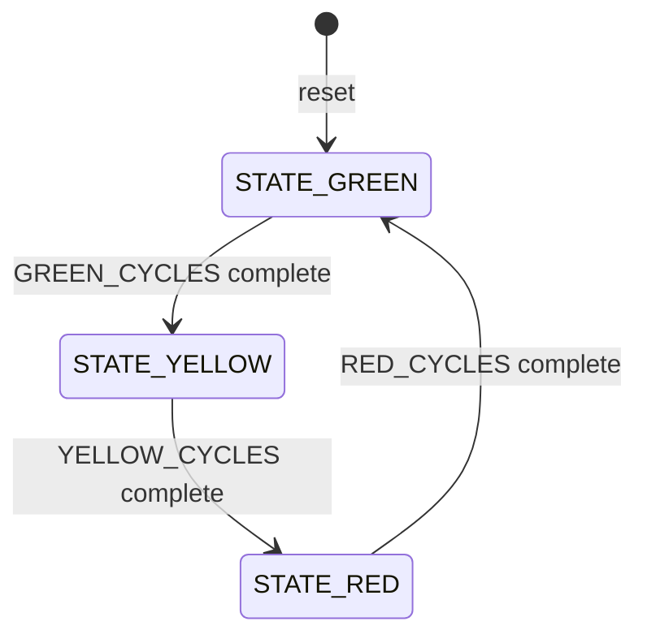
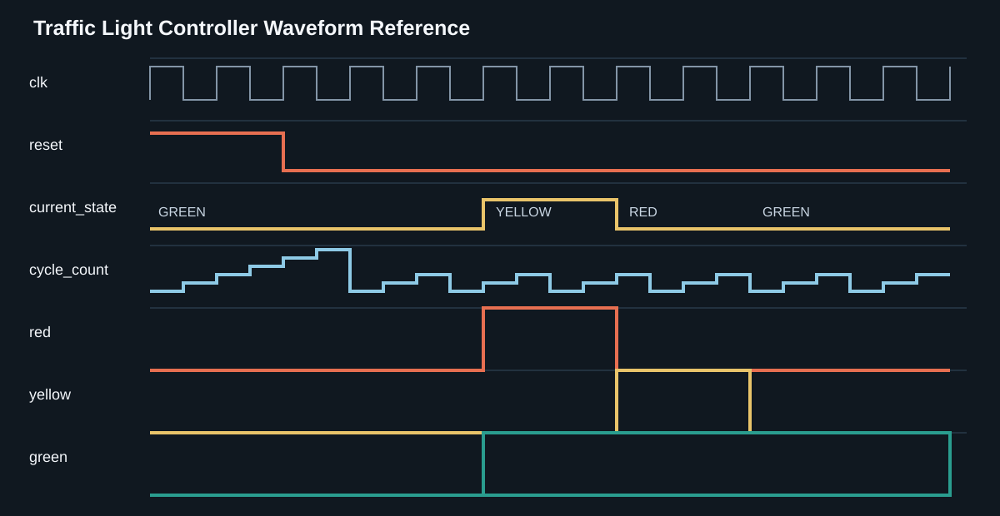

# 🚦 Traffic Light Controller in Verilog


A compact, synthesizable RTL design of a **timed traffic-light controller** built as a **synchronous Moore finite-state machine (FSM)**. The controller cycles through **GREEN → YELLOW → RED**, holding each state for a configurable number of clock cycles, and includes a **self-checking testbench** with waveform dumping.

---

## 📌 Table of Contents

- [Features](#-features)
- [Architecture](#-architecture)
- [FSM Design](#-fsm-design)
- [Timing Behavior](#-timing-behavior)
- [Module Interface](#-module-interface)
- [Parameters](#-parameters)
- [Repository Structure](#-repository-structure)
- [Getting Started](#-getting-started)
- [Simulation](#-simulation)
- [Verification](#-verification)
- [Waveform Analysis](#-waveform-analysis)
- [Known Limitations](#-known-limitations)
- [Possible Extensions](#-possible-extensions)
- [License](#-license)

---

## ✨ Features

- **Three-state Moore FSM** (`GREEN`, `YELLOW`, `RED`) with deterministic transitions
- **Parameterized timing**: set green, yellow, and red durations at instantiation without touching the RTL
- **Synchronous, active-high reset** that returns the controller to `GREEN` on the next clock edge
- **One-hot Moore outputs**: `red`, `yellow`, and `green` are derived only from the current state, so exactly one light is on for every valid state
- **Automatic state duration selection** through a `state_duration` lookup
- **Safe default states** in every `case` statement, so the design recovers from invalid encodings
- **Self-checking testbench** that compares every clock cycle against the expected light pattern and reports `PASS` or `FAIL`
- **VCD waveform dump** (`traffic_light_waveform.vcd`) for GTKWave inspection
- **Small and readable**: the full design fits in one sitting, which makes it a good reference for RTL FSM design

---

## 🧱 Architecture

The design is split into three logical blocks:

| Block | Type | Responsibility |
|---|---|---|
| State register | Sequential (`posedge clk`) | Stores `current_state` and `cycle_count` |
| Next-state logic | Combinational (`always @*`) | Selects `next_state` when the current state's duration is complete |
| Output decoder | Combinational (`always @*`) | Drives exactly one light from `current_state` (Moore output) |

```text
           ┌────────────────────────────────────────────┐
clk ──────►│                                            │
reset ────►│   State Register + cycle_count (sync)      │
           │                                            │
           └──────────────┬─────────────────────────────┘
                          │ current_state
                          ▼
           ┌─────────────────────────────┐     ┌──────────────────┐
           │  Next-state & duration logic │     │  Output decoder  │──► red
           └─────────────────────────────┘     │   (Moore)        │──► yellow
                                               └──────────────────┘──► green
```

---

## 🔄 FSM Design

### State Encoding

| State | Encoding | Red | Yellow | Green | Duration (default) |
|---|:---:|:---:|:---:|:---:|:---:|
| `STATE_GREEN`  | `2'b00` | 0 | 0 | 1 | 5 clock cycles |
| `STATE_YELLOW` | `2'b01` | 0 | 1 | 0 | 2 clock cycles |
| `STATE_RED`    | `2'b10` | 1 | 0 | 0 | 5 clock cycles |

### State Diagram



---

## ⏱️ Timing Behavior

Each state is held for its configured number of clock cycles. The `cycle_count` register increments while a state is active. When `cycle_count` reaches `state_duration - 1`, the next-state logic selects the following state, and the counter resets to zero on the next clock edge.

With the default parameters, one full traffic cycle lasts **12 clock cycles**:

```text
Clock cycle : 0  1  2  3  4  5  6  7  8  9  10 11 | 12 ...
State       : G  G  G  G  G  Y  Y  R  R  R  R  R  | G  ...
Red         : 0  0  0  0  0  0  0  1  1  1  1  1  | 0
Yellow      : 0  0  0  0  0  1  1  0  0  0  0  0  | 0
Green       : 1  1  1  1  1  0  0  0  0  0  0  0  | 1
```

Operation sequence:

1. On a rising edge of `clk` with `reset = 1`, the FSM moves to `STATE_GREEN` and clears `cycle_count`.
2. While a state is active, `cycle_count` increments once per clock cycle.
3. On the final cycle of the state, `next_state` changes and the counter resets.
4. The output decoder asserts only the light associated with the current state.

---

## 🔌 Module Interface

```verilog
module traffic_light_controller #(
    parameter integer GREEN_CYCLES  = 5,
    parameter integer YELLOW_CYCLES = 2,
    parameter integer RED_CYCLES    = 5
) (
    input  wire clk,
    input  wire reset,
    output reg  red,
    output reg  yellow,
    output reg  green
);
```

| Signal | Direction | Width | Description |
|---|---|:---:|---|
| `clk` | Input | 1 | System clock. State and counter update on the rising edge. |
| `reset` | Input | 1 | Synchronous, active-high reset. Forces `STATE_GREEN` and clears the counter. |
| `red` | Output | 1 | High only during `STATE_RED`. |
| `yellow` | Output | 1 | High only during `STATE_YELLOW`. |
| `green` | Output | 1 | High only during `STATE_GREEN`. |

---

## ⚙️ Parameters

| Parameter | Default | Description |
|---|:---:|---|
| `GREEN_CYCLES` | 5 | Number of clock cycles the green light stays on |
| `YELLOW_CYCLES` | 2 | Number of clock cycles the yellow light stays on |
| `RED_CYCLES` | 5 | Number of clock cycles the red light stays on |

Override the timing at instantiation:

```verilog
traffic_light_controller #(
    .GREEN_CYCLES  (10),
    .YELLOW_CYCLES (3),
    .RED_CYCLES    (10)
) dut (
    .clk    (clk),
    .reset  (reset),
    .red    (red),
    .yellow (yellow),
    .green  (green)
);
```

> **Note:** Each duration must be at least `1`. A value of `1` holds the state for a single clock cycle.

---

## 📁 Repository Structure

```text
TRAFFIC-LIGHT-CONTROLLER-VERILOG/
├── rtl/
│   └── traffic_light_controller.v        # Synthesizable RTL design
├── tb/
│   └── traffic_light_controller_tb.v     # Self-checking testbench
├── waveform/
│   └── traffic_light_waveform.svg        # Waveform screenshot (optional)
├── docs/
│   └── block_diagram.svg                 # Architecture diagram
└── README.md
```

---

## 🚀 Getting Started

### Prerequisites

| Tool | Purpose | Link |
|---|---|---|
| Icarus Verilog | Compile and simulate the design | [steveicarus.github.io/iverilog](https://steveicarus.github.io/iverilog/) |
| GTKWave | View the generated waveform | [gtkwave.sourceforge.net](https://gtkwave.sourceforge.net/) |

### Clone the Repository

```sh
git clone https://github.com/<your-username>/TRAFFIC-LIGHT-CONTROLLER-VERILOG.git
cd TRAFFIC-LIGHT-CONTROLLER-VERILOG
```

---

## ▶️ Simulation

### 1. Compile

Run from the repository root:

```sh
iverilog -g2012 -o traffic_sim rtl/traffic_light_controller.v tb/traffic_light_controller_tb.v
```

### 2. Run

```sh
vvp traffic_sim
```

### 3. Expected Output

```text
PASS: traffic light FSM timing, sequence, and one-hot outputs verified.
```

If a mismatch occurs, the testbench prints the failing time and the observed light pattern, for example:

```text
ERROR at 125000: expected YELLOW lights, got RYG=001
FAIL: 1 error(s) detected.
```

### 4. View the Waveform

The testbench writes `traffic_light_waveform.vcd` to the repository root. Open it with:

```sh
gtkwave traffic_light_waveform.vcd
```

### Recommended GTKWave Signals

| Signal | Purpose |
|---|---|
| `clk`, `reset` | Verify clock edges and reset behavior |
| `dut.current_state` | Confirm the FSM sequence (`00 → 01 → 10 → 00`) |
| `dut.cycle_count` | Confirm the duration of each state |
| `red`, `yellow`, `green` | Confirm one-hot light outputs |

### Simulation Workflow Summary

```text
  ┌──────────┐     ┌──────────┐     ┌──────────────┐     ┌────────────────┐
  │  Compile │ ──► │   Run    │ ──► │  PASS / FAIL │ ──► │ Waveform (VCD) │
  │ (iverilog)│    │  (vvp)   │     │  console log │     │   (GTKWave)    │
  └──────────┘     └──────────┘     └──────────────┘     └────────────────┘
```

---

## ✅ Verification

The self-checking testbench (`traffic_light_controller_tb.v`) runs with a 10 ns clock period (`always #5 clk = ~clk`) and checks the outputs one time unit after each rising edge.

### Test Scenarios

| # | Test | Expected Result |
|---|---|---|
| 1 | Reset is applied for 2 clock edges | Output is `green = 1`, `yellow = 0`, `red = 0` |
| 2 | Green phase duration | Green stays active for `GREEN_CYCLES` (5) cycles |
| 3 | Yellow phase duration | Yellow stays active for `YELLOW_CYCLES` (2) cycles |
| 4 | Red phase duration | Red stays active for `RED_CYCLES` (5) cycles |
| 5 | Sequence order | Transitions occur in the order GREEN → YELLOW → RED → GREEN |
| 6 | Continuous operation | A full additional cycle (12 clock cycles) runs with one-hot checks |
| 7 | One-hot outputs | No more than one light is active at any time |

### How the Testbench Works

- `check_lights` compares `{red, yellow, green}` against the expected pattern and reports any mismatch.
- `check_one_hot` confirms that exactly one light is active during the continuous-operation phase.
- An `errors` counter accumulates all failures.
- The final message is `PASS` when `errors == 0`, otherwise `FAIL` with the error count.

---

## 📈 Waveform Analysis

When inspecting the waveform in GTKWave, confirm the following:

- After reset, `current_state` is `00` and `green` is high.
- `cycle_count` counts `0 → 4` during green, then resets to `0` on the transition to yellow.
- Yellow lasts two clock cycles (`cycle_count` counts `0 → 1`).
- Red lasts five clock cycles, then the sequence returns to green.
- Only one of `red`, `yellow`, and `green` is high at any time.

> 📷 Add a GTKWave screenshot to `waveform/traffic_light_waveform.svg` (or export it as PNG) and reference it here:
>
> `



`

---

## ⚠️ Known Limitations

- Single-road controller only. There is no two-way intersection logic.
- No pedestrian crossing request or emergency vehicle preemption.
- Timing values are fixed at instantiation and cannot be changed at runtime.
- Reset is synchronous, so it takes effect only on a rising clock edge.
- Duration parameters are not range-checked. Values below `1` are not supported.
- The design has not been synthesized for a specific FPGA target yet.

---

## 🔭 Possible Extensions

- [ ] Two-way intersection control with coordinated phases
- [ ] Pedestrian crossing request input and walk/don't-walk output
- [ ] Emergency vehicle priority override
- [ ] Night mode (flashing yellow)
- [ ] Traffic density input from vehicle sensors
- [ ] Runtime-configurable timing profiles
- [ ] FPGA implementation with board-level LEDs (e.g., Basys 3 or Nexys A7)
- [ ] Assertion-based verification (SystemVerilog Assertions)

---

## 🛠️ Technologies Used

- **Verilog HDL** (IEEE 1364-2005, compiled with `-g2012`)
- **RTL finite state machine design**
- **Icarus Verilog** for simulation
- **GTKWave** for waveform inspection

---

## 📜 License

This project is intended as an educational and portfolio reference for digital design and Verilog RTL development.
